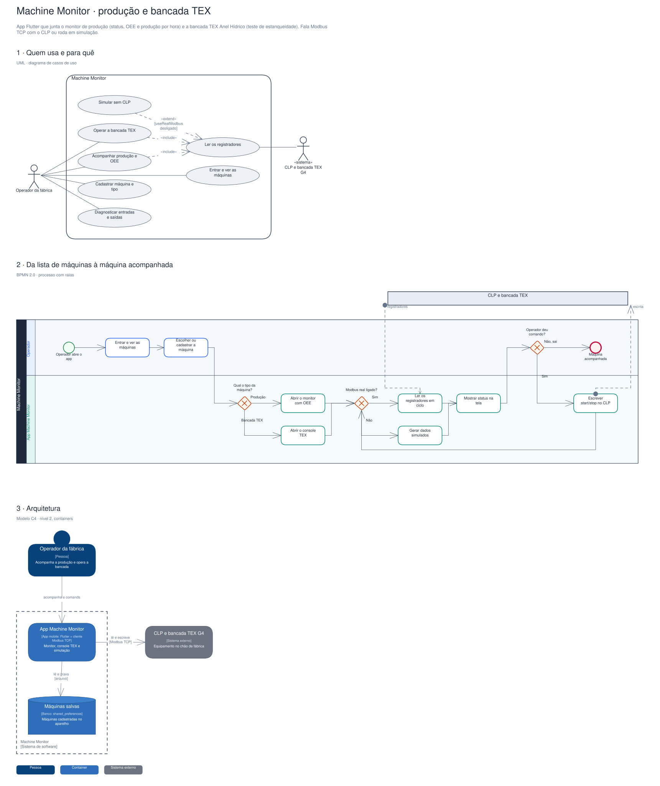

# Arquitetura

Diagramas gerados a partir do Sinapse (o segundo cérebro do Pedro). Cada projeto tem três vistas,
cada uma numa notação padrão:

1. **Quem usa e para quê**: UML, diagrama de casos de uso.
2. **O processo principal**: BPMN 2.0, com raias por quem executa.
3. **A arquitetura**: modelo C4, nível 2 (containers).

## Machine Monitor · produção e bancada TEX

App Flutter que junta o monitor de produção (status, OEE e produção por hora) e a bancada TEX Anel Hídrico (teste de estanqueidade). Fala Modbus TCP com o CLP ou roda em simulação.

Editável: [`machine-monitor.excalidraw`](./machine-monitor.excalidraw), abre em [excalidraw.com](https://excalidraw.com) ou no VS Code com a extensão Excalidraw.

A fonte destes arquivos é o vault do Sinapse (`09-DESENHOS/`); alterações feitas aqui são sobrescritas na próxima publicação.
